# ОТЧЁТ ПО ЛАБОРАТОРНОЙ РАБОТЕ № 6
## Система контроля версий

**Выполнила:** студентка группы 4514 Неизвестная М. А.  
**Личный репозиторий:** [https://github.com/whymarquofe/LR6](https://github.com/whymarquofe/LR6)  
**Исходный репозиторий:** [https://github.com/Kurtyanik/LR6/](https://github.com/Kurtyanik/LR6/)  

---

## Содержание
1. [Цель лабораторной работы](#1-цель-лабораторной-работы)
2. [Ход выполнения работы](#2-ход-выполнения-работы)
   * [Пункты 1–5. Создание аккаунта, форк, установка, настройка и клонирование](#пункты-15-создание-аккаунта-форк-установка-настройка-и-клонирование)
   * [Пункт 6. Добавление файла через интерфейс GitHub и подтягивание изменений](#пункт-6-добавление-файла-через-интерфейс-github-и-подтягивание-изменений)
   * [Пункт 7. Получение истории операций для каждой из веток](#пункт-7-получение-истории-операций-для-каждой-из-веток)
   * [Пункт 8. Просмотр последних изменений](#пункт-8-просмотр-последних-изменений)
   * [Пункт 9. Выполнение слияния в ветку master с разрешением конфликта](#пункт-9-выполнение-слияния-в-ветку-master-с-разрешением-конфликта)
   * [Пункт 10. Удаление побочной ветки после успешного слияния](#пункт-10-удаление-побочной-ветки-после-успешного-слияния)
   * [Пункт 11. Выполнение нескольких изменений и их фиксация с комментариями](#пункт-11-выполнение-нескольких-изменений-и-их-фиксация-с-комментариями)
   * [Пункт 12. Выполнение отката коммита](#пункт-12-выполнение-отката-коммита)
   * [Пункты 13–14. Создание ветки для отчёта и оформление README.md](#пункты-1314-создание-ветки-для-отчёта-и-оформление-readmemd)
   * [Пункт 15. Форматированная история операций](#пункт-15-форматированная-история-операций)
   * [Пункт 16. Отправка локальных изменений в сетевое хранилище GitHub](#пункт-16-отправка-локальных-изменений-в-сетевое-хранилище-github)
3. [Лог выполненных команд](#3-лог-выполненных-команд)
4. [Заключение](#4-заключение)

---

## 1. Цель лабораторной работы
Изучение базовых возможностей системы управления версиями, опыт работы с Git API, опыт работы с локальным и удалённым репозиторием.

---

## 2. Ход выполнения работы

### Пункты 1–5. Создание аккаунта, форк, установка, настройка и клонирование
1. На сервисе GitHub создана учётная запись `whymarquofe`.
2. Выполнено копирование (Fork) исходного репозитория `https://github.com/Kurtyanik/LR6/` в личное хранилище `whymarquofe/LR6` (рисунок 1).

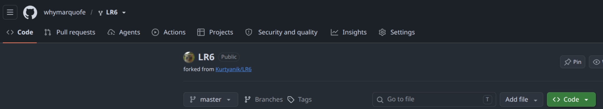  
*Рисунок 1 — Создание копии (Fork) репозитория на GitHub*

3. В операционной системе Ubuntu Linux установлен клиент системы контроля версий Git с помощью пакетного менеджера `apt` (`sudo apt install git`).
4. Выполнена глобальная настройка клиента Git с указанием имени пользователя в формате «Группа Фамилия И.О.» и электронной почты (рисунок 2).

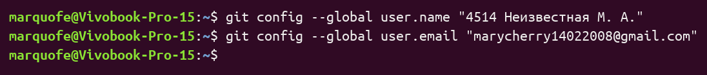  
*Рисунок 2 — Настройка имени пользователя и email в клиенте Git*

5. Личный удалённый репозиторий склонирован на локальный компьютер в директорию `~/LR6` командой `git clone` (рисунок 3).

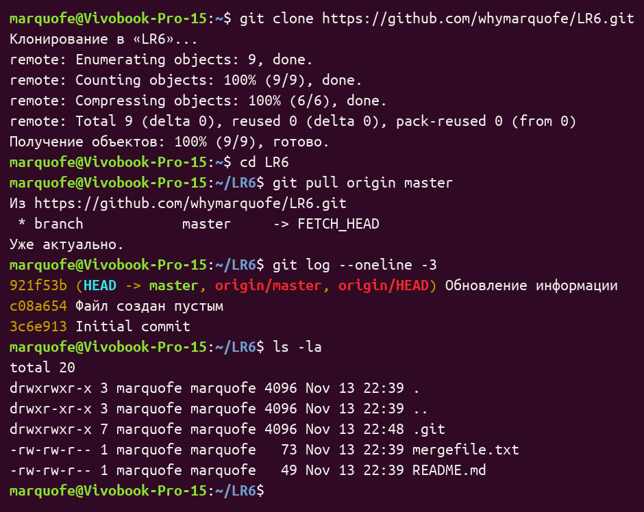  
*Рисунок 3 — Клонирование удалённого репозитория на компьютер*

### Пункт 6. Добавление файла через интерфейс GitHub и подтягивание изменений
Через веб-интерфейс GitHub в основную ветку `master` добавлен файл `github_file.txt` с фиксацией изменений (рисунок 4). После этого изменения подтянуты в локальный репозиторий командой `git pull origin master` (рисунок 5).

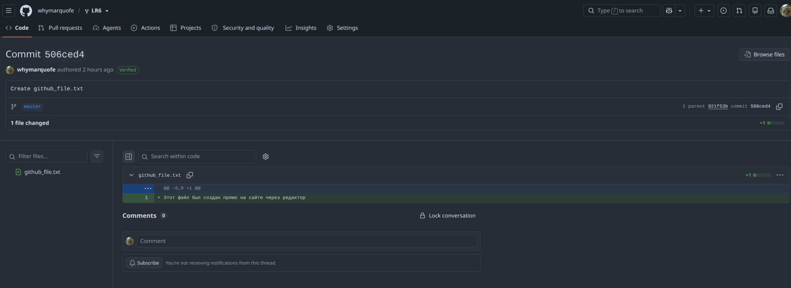  
*Рисунок 4 — Добавление файла через веб-интерфейс GitHub*

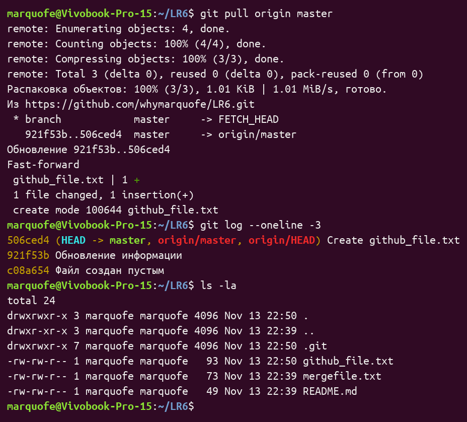  
*Рисунок 5 — Подтягивание изменений в локальный репозиторий*

### Пункт 7. Получение истории операций для каждой из веток
Выполнено обновление сведений об удалённых ветках (`git fetch --all --prune`), переключение на ветку `branch1` (`git switch branch1`), а также получен журнал коммитов отдельно для веток `master` и `branch1` (рисунок 6) и общий граф ветвления (рисунок 7).

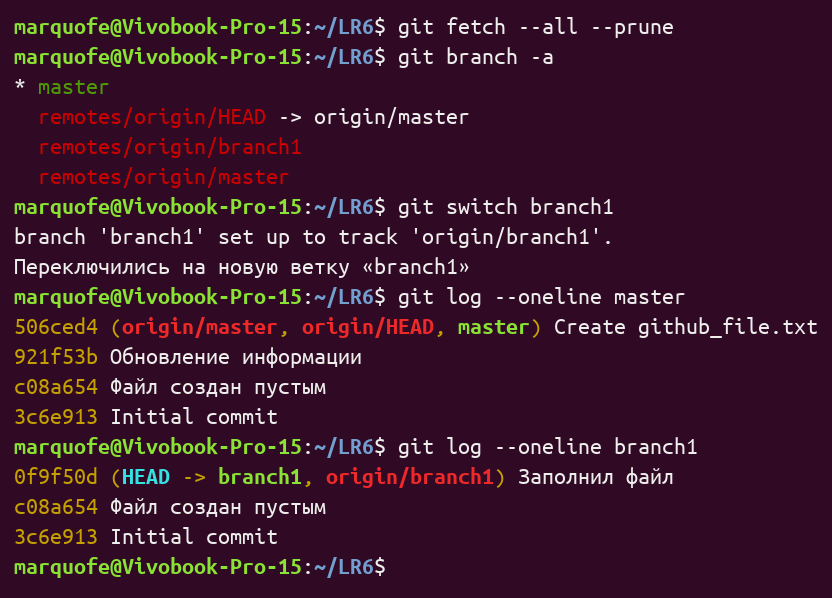  
*Рисунок 6 — История операций по веткам master и branch1*

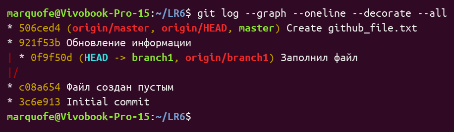  
*Рисунок 7 — Граф истории операций по всем веткам*

### Пункт 8. Просмотр последних изменений
С помощью команд `git log -2 -p`, `git show HEAD` и `git diff HEAD~1 HEAD` выполнен детальный просмотр изменений, внесённых последним коммитом `0f9f50d` в файл `mergefile.txt` (рисунок 8).

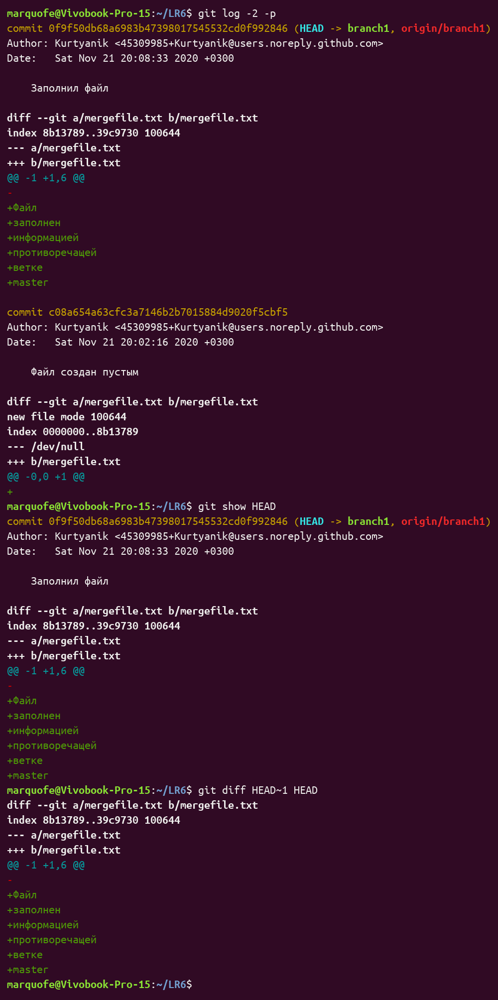  
*Рисунок 8 — Просмотр последних изменений в репозитории*

### Пункт 9. Выполнение слияния в ветку master с разрешением конфликта
После переключения в ветку `master` (`git switch master`) запущено слияние с веткой `branch1` (`git merge branch1`), в результате чего возник конфликт содержимого в файле `mergefile.txt` (рисунок 9).

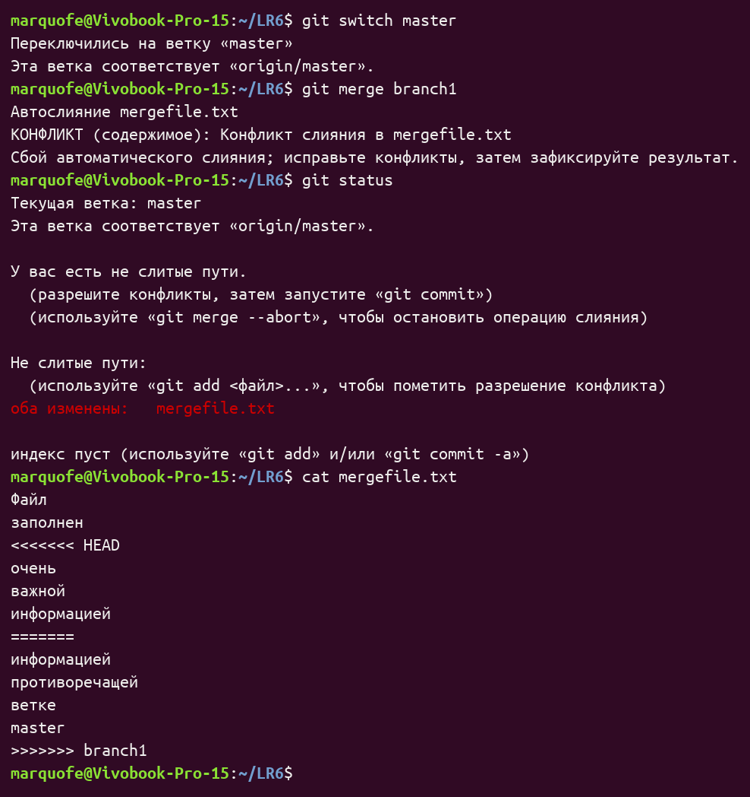  
*Рисунок 9 — Возникновение конфликта при слиянии веток*

В текстовом редакторе `nano` файл `mergefile.txt` приведён к согласованному виду с удалением маркеров конфликта (`<<<<<<<`, `=======`, `>>>>>>>`), после чего выполнен коммит слияния `78acea1` (рисунок 10).

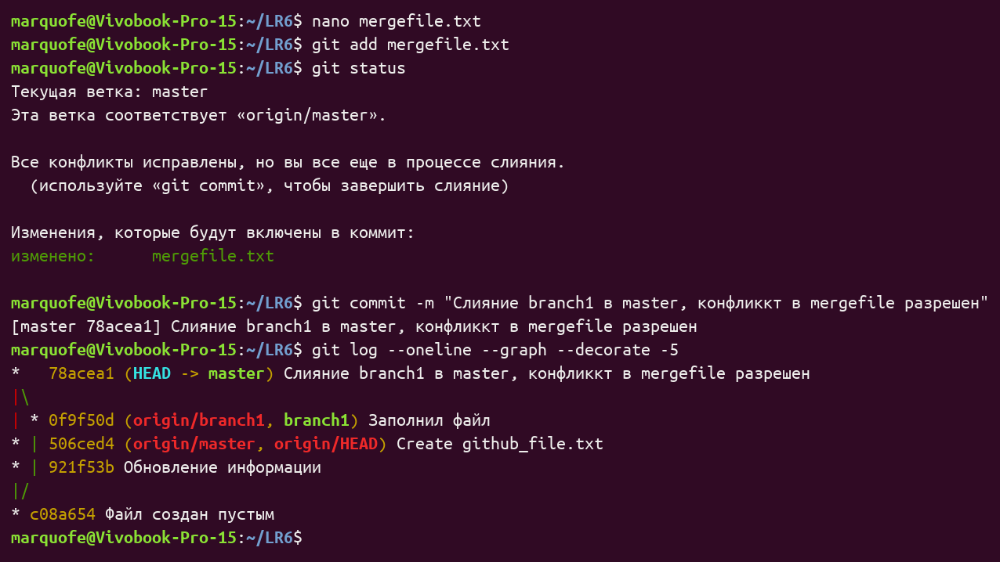  
*Рисунок 10 — Разрешение конфликта и фиксация результата слияния*

### Пункт 10. Удаление побочной ветки после успешного слияния
После переноса изменений в `master` побочная локальная ветка `branch1` удалена командой `git branch -d branch1` с проверкой списка веток (рисунок 11).

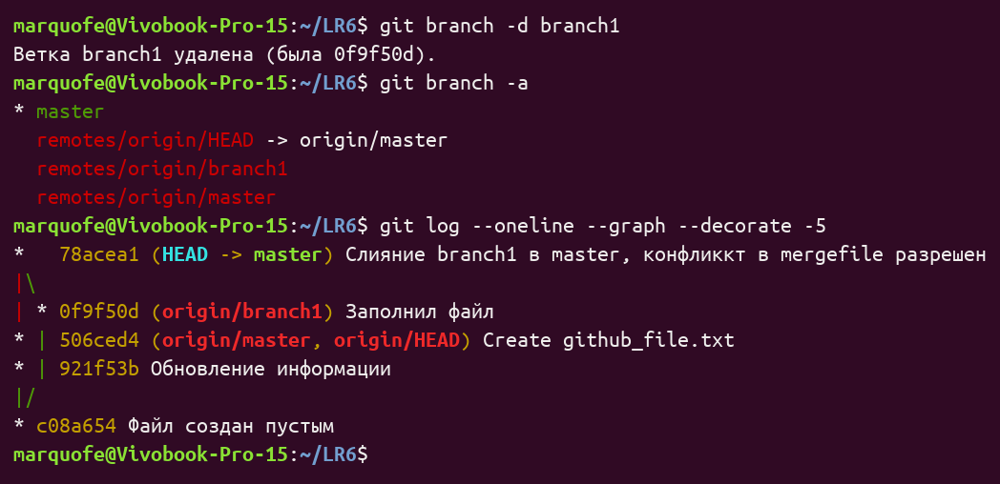  
*Рисунок 11 — Удаление побочной ветки branch1*

### Пункт 11. Выполнение нескольких изменений и их фиксация с комментариями
В ветке `master` последовательно выполнены и зафиксированы три изменения с осмысленными комментариями: создание файла `notes.txt`, дополнение его содержимого и редактирование файла `README.md` (рисунок 12).

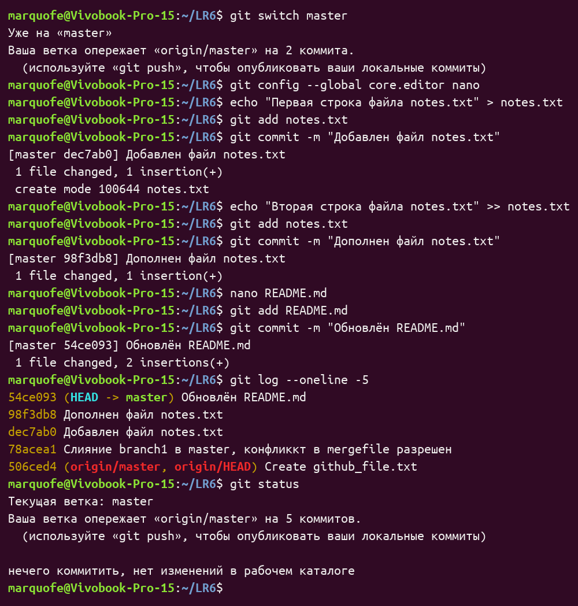  
*Рисунок 12 — Фиксация серии последовательных изменений*

### Пункт 12. Выполнение отката коммита
Выполнен безопасный откат последнего коммита командой `git revert --no-edit HEAD` с созданием коммита отмены `d761a79`, после чего продемонстрирован жёсткий откат указателя истории `git reset --hard HEAD~1`, вернувший ветку на коммит `54ce093` (рисунок 13).

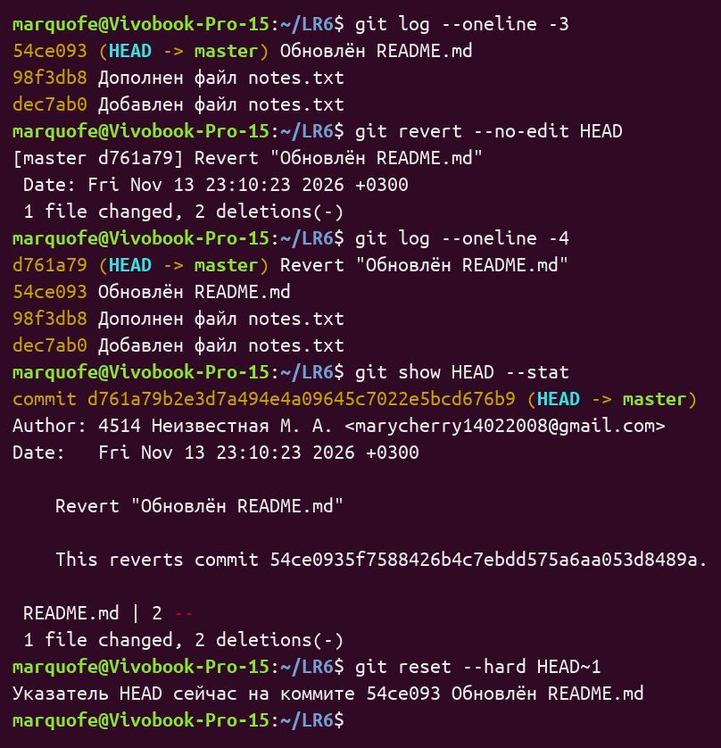  
*Рисунок 13 — Выполнение отката коммита*

### Пункты 13–14. Создание ветки для отчёта и оформление README.md
Создана отдельная ветка `report` (`git switch -c report`) (рисунок 14), после чего она отправлена в удалённый репозиторий командой `git push -u origin report`. В ветке создана директория `screenshots` для хранения снимков экрана и выполнено оформление данного отчёта в файле `README.md` с использованием синтаксиса Markdown и промежуточной фиксацией изменений (рисунок 15).

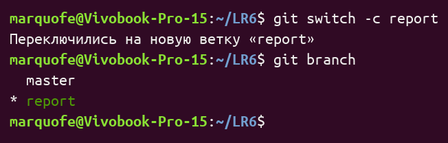  
*Рисунок 14 — Создание ветки report*

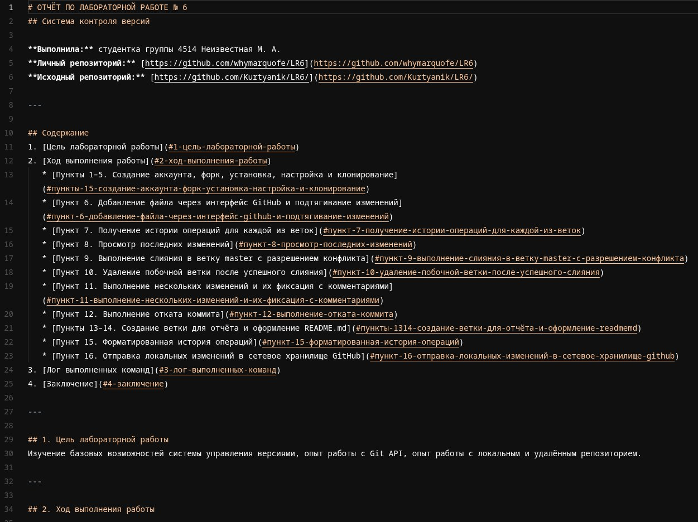  
*Рисунок 15 — Оформление файла отчёта README.md*

### Пункт 15. Форматированная история операций
С помощью команды `git log --pretty=format:"| %h | %ad | %an | %s |" --date=format:"%d.%m.%Y" --all` получена история операций в форматированном виде (рисунок 16), представленная в таблице 1.

*Таблица 1 — Форматированная история операций репозитория*

| Сокращённый хэш | Дата | Имя автора | Комментарий |
| :--- | :--- | :--- | :--- |
| 54ce093 | 13.11.2026 | 4514 Неизвестная М. А. | Обновлён README.md |
| 98f3db8 | 13.11.2026 | 4514 Неизвестная М. А. | Дополнен файл notes.txt |
| dec7ab0 | 13.11.2026 | 4514 Неизвестная М. А. | Добавлен файл notes.txt |
| 78acea1 | 13.11.2026 | 4514 Неизвестная М. А. | Слияние branch1 в master, конфликкт в mergefile разрешен |
| 506ced4 | 13.11.2026 | whymarquofe | Create github_file.txt |
| 921f53b | 21.11.2020 | Kurtyanik | Обновление информации |
| 0f9f50d | 21.11.2020 | Kurtyanik | Заполнил файл |
| c08a654 | 21.11.2020 | Kurtyanik | Файл создан пустым |
| 3c6e913 | 21.11.2020 | Kurtyanik | Initial commit |

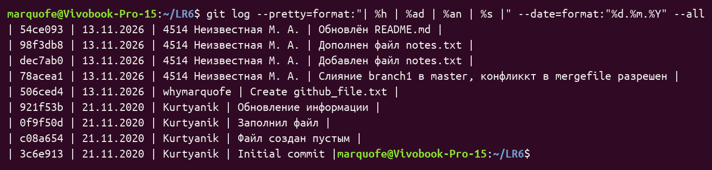  
*Рисунок 16 — Получение форматированной истории операций*

### Пункт 16. Отправка локальных изменений в сетевое хранилище GitHub
После финальной фиксации изменений в отчёте выполнено слияние ветки `report` в `master` и отправка всех локальных изменений в сетевое хранилище GitHub командой `git push` (рисунки 17 и 18).

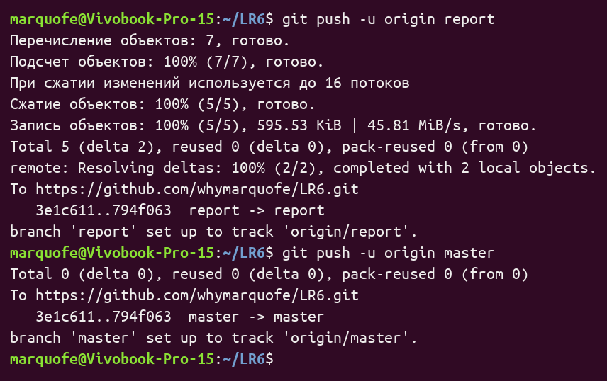  
*Рисунок 17 — Отправка локальных изменений в сетевое хранилище GitHub*

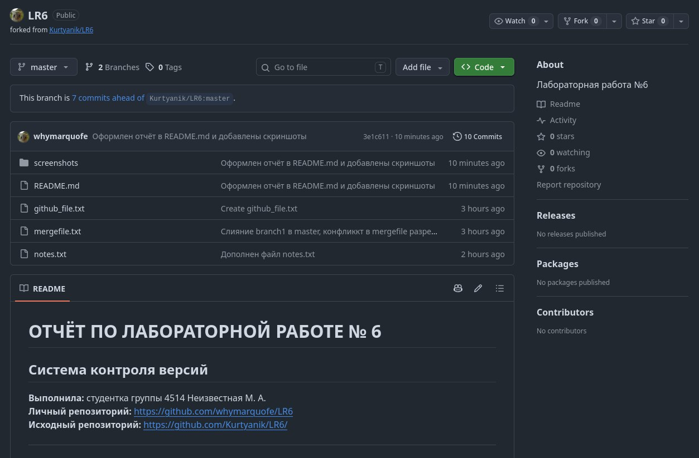  
*Рисунок 18 — Итоговое состояние личного репозитория на GitHub*

---

## 3. Лог выполненных команд

```bash
sudo apt install git
git config --global user.name "4514 Неизвестная М. А."
git config --global user.email "marycherry14022008@gmail.com"
git clone https://github.com/whymarquofe/LR6.git
cd LR6
git pull origin master
git log --oneline -3
ls -la
git fetch --all --prune
git branch -a
git switch branch1
git log --oneline master
git log --oneline branch1
git log --graph --oneline --decorate --all
git log -2 -p
git show HEAD
git diff HEAD~1 HEAD
git switch master
git merge branch1
git status
nano mergefile.txt
git add mergefile.txt
git status
git commit -m "Слияние branch1 в master, конфликкт в mergefile разрешен"
git log --oneline --graph --decorate -5
git branch -d branch1
git branch -a
git config --global core.editor nano
echo "Первая строка файла notes.txt" > notes.txt
git add notes.txt
git commit -m "Добавлен файл notes.txt"
echo "Вторая строка файла notes.txt" >> notes.txt
git add notes.txt
git commit -m "Дополнен файл notes.txt"
nano README.md
git add README.md
git commit -m "Обновлён README.md"
git log --oneline -5
git status
git revert --no-edit HEAD
git log --oneline -4
git show HEAD --stat
git reset --hard HEAD~1
git switch -c report
git branch
git push -u origin report
mkdir -p screenshots
git log --pretty=format:"| %h | %ad | %an | %s |" --date=format:"%d.%m.%Y" --all
git add .
git commit -m "Оформлен отчёт в README.md и добавлены скриншоты"
git push origin report
git switch master
git merge report
git push -u origin master
```

---

## 4. Заключение
В ходе выполнения лабораторной работы № 6 изучены базовые возможности системы управления версиями Git и получены практические навыки работы с локальным и удалённым репозиториями на платформе GitHub. Отработаны операции создания копии репозитория (Fork), клонирования, синхронизации изменений, работы с ветками, разрешения конфликтов слияния, отката коммитов и оформления отчётной документации в формате Markdown.
